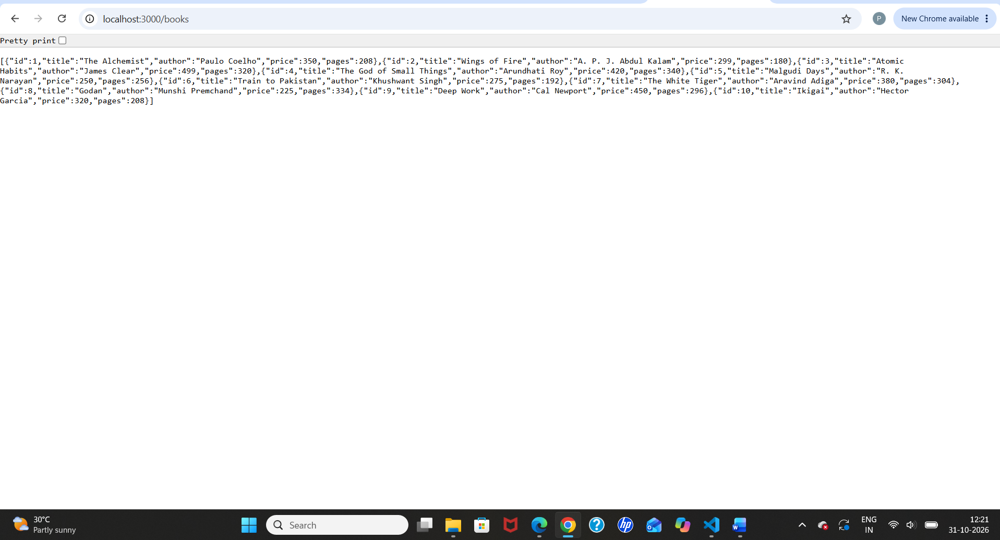
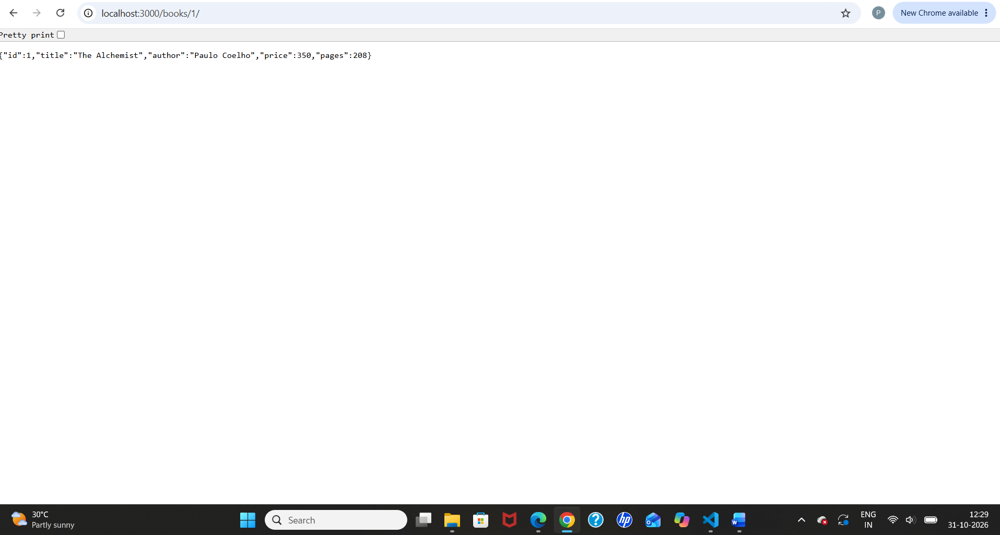
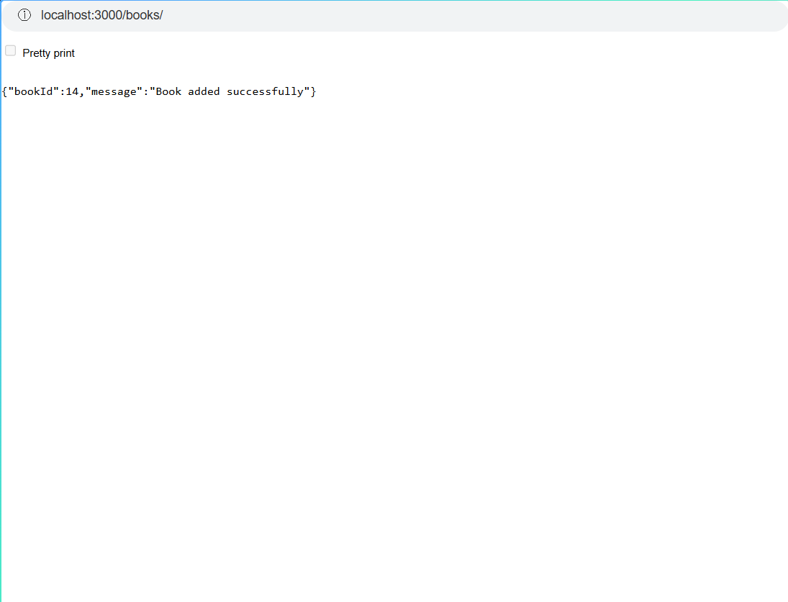
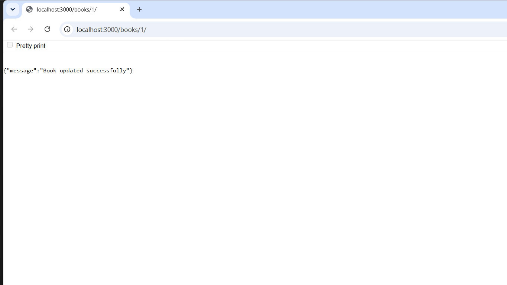
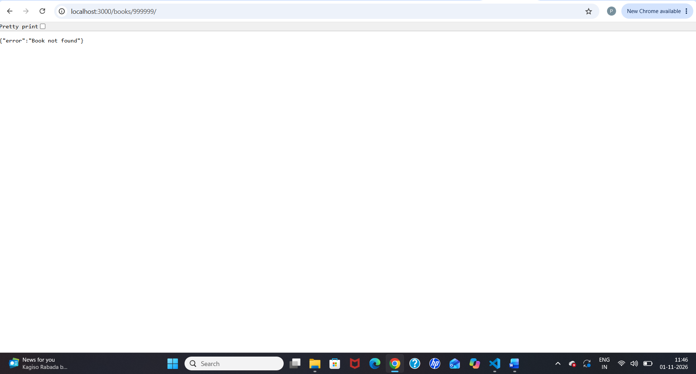
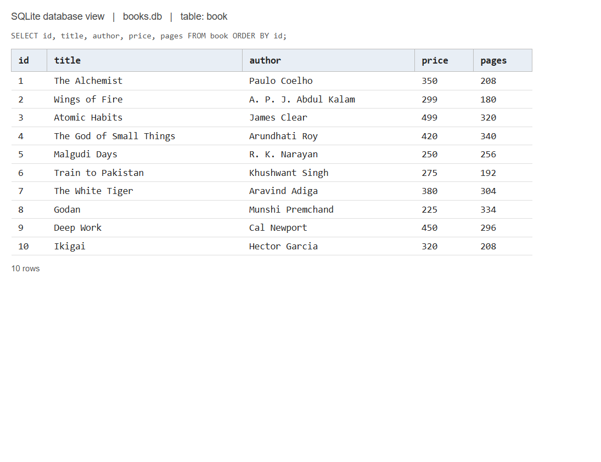

# Lab 2: SQLite database and CRUD routes

**Name:** Pendyal Praveen Kumar · **Registration number:** 252U1R9123 · **Section:** CSE GEN-AI-2B 111

**Live link:** https://github.com/praveenshetty141/lab-02-sqlite-crud/tree/main

## How to run

```bash
cd lab-02
npm install            # installs express, sqlite, sqlite3 and nodemon
cp .env.example .env   # optional: edit PORT / DB_PATH (no real secrets are needed)
npm run dev            # starts with nodemon (restarts on every change)
# or: npm start        # plain node
```

Environment variables (see `.env.example`):

| Variable | Default | Meaning |
| --- | --- | --- |
| `PORT` | `3000` | Port the server listens on |
| `DB_PATH` | `books.db` | SQLite database file (relative to this folder) |

The database file `books.db` is included with 10 sample rows. To recreate it from scratch:

```bash
rm books.db
sqlite3 books.db < schema.sql
```

## Endpoints

| Method | Path | Description |
| --- | --- | --- |
| GET | `/books/` | Return all books |
| GET | `/books/:bookId/` | Return one book (404 if it does not exist) |
| POST | `/books/` | Add a book from JSON body `{title, author, price, pages}` (201) |
| PUT | `/books/:bookId/` | Update every field of a book (404 if it does not exist) |
| DELETE | `/books/:bookId/` | Delete a book (404 if it does not exist) |

Status codes used: `200` OK, `201` Created, `400` invalid id or body, `404` not found, `500` server error.

Sample body for POST / PUT:

```json
{ "title": "Deep Work", "author": "Cal Newport", "price": 450, "pages": 296 }
```

## Screenshots

Add your Postman and SQLite CLI screenshots to `screenshots/` and show them here:









## Notes: problems faced and how I solved them

- _Write your own notes here (e.g. the server started before the DB opened, so I moved `app.listen` inside `initializeDBAndServer()`)._
